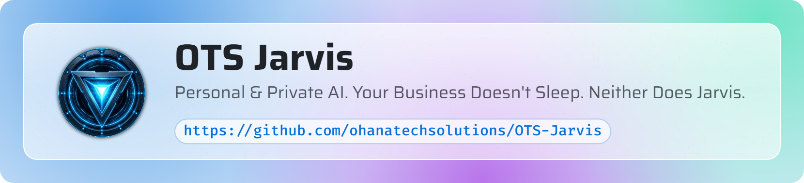

<p align="center">
  <picture>
    <source media="(prefers-color-scheme: dark)" srcset="art/header-dark.png" />
    
  </picture>
</p>

# OTS Jarvis

<p align="center">
  <strong>Self-hosted AI assistance for business workflows — early local pilot.</strong>
</p>

<p align="center">
  A local-first assistant foundation by <strong>Ohana Tech Solutions</strong>, designed to help small businesses work with local AI today and progressively introduce supervised automation.
</p>

<p align="center">
  
  
  
</p>

> [!IMPORTANT]
> **Current scope: single-administrator localhost pilot.** This repository does **not** yet provide a multi-employee agent platform, remote access, autonomous business integrations, or a verified Windows installer. The source is in development. See [Project Status](docs/PROJECT_STATUS.md), [Build Blueprint](docs/BUILD_BLUEPRINT.md), and [Test Evidence](docs/TEST_EVIDENCE.md) for the scope and actual verification record.

---

##  Why This Exists

Small businesses spend time switching between inboxes, websites, calendars, and repetitive administrative work. OTS Jarvis is being developed as a local-first foundation for AI assistance, with business automation added only when authorization, privacy, and accountability are established. The current pilot focuses on the first reliable step: authenticated access to a locally running AI model, with response history and explicit failure handling.

<table>
  <tr>
    <td width="33%" align="center" valign="top">
      
      <h3>The Problem</h3>
      <p>Repetitive workflows and fragmented information slow down day-to-day business work. An AI assistant also needs clear boundaries before it can safely act on company information.</p>
    </td>
    <td width="34%" align="center" valign="top">
      
      <h3>The Purpose</h3>
      <p>Establish a privately operated assistant foundation that can grow into supervised, auditable assistance for Island Craft Fairs and future small-business workflows.</p>
    </td>
    <td width="33%" align="center" valign="top">
      
      <h3>The Solution</h3>
      <p>The current source pilot provides administrator login, localhost model requests, selectable output depth, and temporary task history. Employee access and real-world automation remain planned.</p>
    </td>
  </tr>
</table>

---

##  How It Works

1. **Start locally:** Run the Python service on your computer. The assistant web interface is served only on `127.0.0.1`.
2. **Enroll and authenticate:** On first launch, use the one-time setup code printed in the local server console to create the sole administrator account. Later visits require sign-in.
3. **Choose response depth:** Submit a prompt with **AUTO**, **Low**, **Medium**, or **High**. AUTO selects an output-token budget using deterministic prompt rules; it does **not** enable a verified model-specific reasoning mode.
4. **Ask the local model:** Jarvis sends the request to a **separately installed**, OpenAI-compatible, loopback-only model runner. The pilot has no cloud inference fallback.
5. **View the outcome:** The browser displays the reply or a recoverable error. SQLite stores local task history with a seven-day expiry policy, applied at service startup.
6. **Approve local note actions:** On the supervised-actions panel, propose a note and review its full contents. Nothing is saved until the administrator clicks **Approve & save**. You can cancel a pending note, undo a completed save, or pause new actions. Model text never directly calls tools.

```text
Local browser (127.0.0.1)
          |
          v
Python HTTP service + session checks
          |-- SQLite: admin, sessions and task history
          |-- AUTO / Low / Medium / High routing
          +-- Loopback model adapter
                    |
                    v
        Separately installed local AI runner
```

See the [architecture and acceptance requirements](docs/BUILD_BLUEPRINT.md) for exact service boundaries.

---

##  Tech Stack

| Component | Technology | Role |
| :--- | :--- | :--- |
| Core service |  **Python 3.11+** | Standard-library HTTP service, authentication, and model adapter |
| Local persistence |  **SQLite** | Administrator, session, prompt history, pending approvals, notes and redacted action audit |
| Browser interface |  **HTML, CSS, JavaScript** | Local dashboard, enrollment, login, prompt entry, and history |
| AI connection | **OpenAI-compatible local HTTP API** | Sends requests to an independently installed local inference runner |
| Packaging | **setuptools; PyInstaller recipe** | Python source/wheel distribution; Windows executable build instructions are present but unverified |

**Model target:** Qwen3.5 9B is the preferred local model in the project plan, **not** an included model or one verified on the Intel NUC. You must supply a compatible runner and its actual model ID. No real-model throughput or context-length benchmark has been validated.

---

##  Installation & Usage

### Prerequisites

- Python **3.11 or newer**.
- A separately installed local inference runner exposing an **OpenAI-compatible chat-completions** endpoint over loopback HTTP (required for successful AI replies).
- A model installed and loaded in that runner. The exact runner URL and model name may differ from the examples.
- Source execution has not yet been validated as a clean Windows installer. The documented automated test environment is Linux/Python 3.13.5.

### Windows PowerShell — run from source

```powershell
# From the OTS-Jarvis repository root
$env:JARVIS_MODEL_ENDPOINT = "http://127.0.0.1:1337/v1"
$env:JARVIS_MODEL = "qwen3.5-9b"  # Replace with your runner's loaded model ID
python -m jarvis
```

### Linux — run from source

```bash
# From the OTS-Jarvis repository root
export JARVIS_MODEL_ENDPOINT=http://127.0.0.1:1337/v1
export JARVIS_MODEL=qwen3.5-9b  # Replace with your runner's loaded model ID
python -m jarvis
```

Open **http://127.0.0.1:8745/**. At first launch, the **local terminal** prints a one-time setup code. Enter it in the enrollment screen, create the administrator account, and sign in. The code is not displayed again after successful enrollment.

If the local model is unavailable, setup, sign-in, and existing history remain accessible; a model request returns a visible error. **Jarvis does not install a runner or download model weights automatically.**

| Configuration variable | Default | Purpose |
| :--- | :--- | :--- |
| `JARVIS_PORT` | `8745` | Port for the localhost dashboard |
| `JARVIS_DATA_DIR` | Per-user application data | Local SQLite state directory |
| `JARVIS_MODEL` | `qwen3.5-9b` | Runner-specific model identifier |
| `JARVIS_MODEL_ENDPOINT` | `http://127.0.0.1:1337/v1` | Local OpenAI-compatible API base URL |

Only loopback model endpoints are accepted. **Do not expose the dashboard or model runner through port forwarding, a public network listener, or an internet-facing proxy.**

### Run the available checks

```bash
python -m unittest discover -s tests -v
python -m compileall -q jarvis
node --check jarvis/web/app.js
python -m pip wheel --no-deps --no-build-isolation . -w dist
python tests/smoke_installed.py
```

The Node.js check is optional if Node is installed. The wheel step requires an appropriate local Python build toolchain; installation of build tools is not performed automatically.

**Test scope:** The recorded automated HTTP integration tests use a **synthetic local model server**, not a real Qwen model. The recorded isolated wheel smoke test is not a Windows installer test. Manual Chromium browser automation was blocked by the current execution environment (`ERR_BLOCKED_BY_ADMINISTRATOR`); normal Windows browser UAT remains necessary. Review [Test Evidence](docs/TEST_EVIDENCE.md) and the [Windows Release Checklist](docs/RELEASE_CHECKLIST.md) before treating this as deployable software.

### Security & data handling

The current pilot binds to `127.0.0.1`, checks local origins/hosts, hashes administrator passwords, and uses HttpOnly SameSite session cookies. Requests and model responses have size/time/concurrency limits. **Prompt, reply and saved-note text is stored without database encryption.** Use only synthetic or non-sensitive data while encryption, backup/recovery, privacy controls, and independent security review remain incomplete.

---

##  Roadmap

Roadmap boxes describe **repository-verified source functionality** versus work requiring further testing. They are not a release-readiness certificate.

- [x] **Local pilot code:** Administrator setup, sign-in/sign-out, and loopback-only browser API implemented.
- [x] **Assistant foundation:** Local model adapter, AUTO/Low/Medium/High output budgets, and SQLite task history implemented.
- [x] **Automated pilot checks:** Recorded Linux unit/HTTP integration tests and isolated Python-wheel smoke tests passed using a synthetic model endpoint.
- [ ] **Real model and hardware verification:** Test Qwen3.5 9B on the intended Intel NUC 12, including latency, tokens/sec, GPU usage, memory, and recovery.
- [x] **Limited local approval workflow (code + automated HTTP tests):** Exact-preview `save_note` proposals, explicit administrator approval, atomic note creation, cancel, undo, pause/resume, expiry and redacted audit.
- [ ] **Broader secure agent actions:** Implement and independently verify safely sandboxed tools, controlled model-to-tool orchestration, revocation, user-acceptance and security tests. The limited note workflow is not a general autonomous agent.
- [ ] **Staff and remote access:** Implement approved-device access, role permissions, MFA, and authenticated remote connectivity.
- [ ] **ICF business knowledge and connectors:** Add an approved local knowledge base and supervised Gmail/Sheets/website/TanDM workflows.
- [ ] **Windows distribution:** Build and independently test a real executable, installation, upgrade, rollback, and integrity verification.
- [ ] **Optional Impact monitoring:** Design revocable, opt-in local activity analysis and evidence-based time-savings reporting with privacy safeguards.
- [ ] **Five-pillar integrated deployment:** Brain (NUC 12), Shield (Firewalla Orange), Decoy (Pi 3 B+ / OpenCanary), Secured Pathway (managed VLAN switch), Bouncer (zero-trust identity). All are mandatory for final launch; see [Five-Pillar Launch Gate](docs/FIVE_PILLAR_LAUNCH_GATE.md). Not yet verified.
- [ ] **Production acceptance:** Complete browser accessibility, security, backup, privacy, and user-acceptance gates.

For verified status and blockers, refer to [Project Status](docs/PROJECT_STATUS.md). For intended milestones and requirements, refer to [Build Blueprint](docs/BUILD_BLUEPRINT.md).

---

<p align="center">
  <sub>Developed by <b>Ohana Tech Solutions</b>.</sub>
</p>
